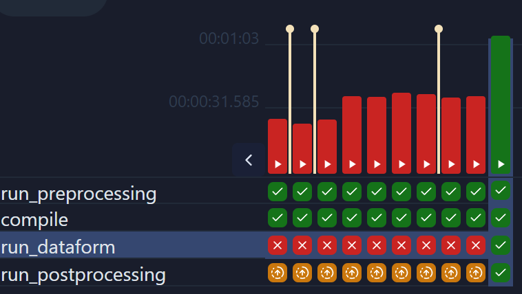
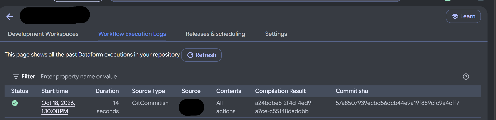

# dataform_test

A small Dataform project on BigQuery, orchestrated by a local Airflow instance. This README describes the **`single-task`** branch: one Dataform invocation runs the whole workflow, and Airflow only wraps it with a preflight check and pre/post steps.

Other branches (`main`, `coarse`, `granular`) hold different structures for comparison. They are not covered here.

## What this branch does

```
Airflow (local, Docker)                              Dataform (GCP)
───────────────────────                              ──────────────
single_task
  ├─ run_preprocessing  ──► single_task_preprocessing
  │                         └─ check_gcp_access      (GCP preflight)
  ├─ compile            ──────────────────────────► compilation result of the git branch
  ├─ run_dataform       ──────────────────────────► one workflow invocation, all actions
  └─ run_postprocessing ──► single_task_postprocessing (placeholder)
```

Dataform reads the git branch, compiles it, and runs every action in `ref()` dependency order. Airflow does not know about individual tables. If you later need per-layer or per-table control, see [Changing the granularity](#changing-the-granularity).

### Screenshots

Airflow: the `single_task` run history. Each column is one run. In this scenario running the whole pipeline boils down to running a single DAG which is simple (all dependencies are handeled by dataform) but gives less UI visibility and control.



Dataform: the workflow execution log for the repository.



## Repository layout

```
.
├── README.md                     this file
├── workflow_settings.yaml        Dataform project config (project and location placeholders)
├── definitions/                  Dataform SQLX actions
│   ├── raw/                      declarations of the raw source tables (not executed)
│   ├── bronze/                   copies of raw tables
│   ├── silver/                   cleaned tables
│   └── golden/                   business output
├── gcp/
│   └── seed_raw_tables.sql       creates the raw dataset and sample tables
├── images/                       screenshots used in this README
└── airflow/
    ├── docker-compose.yaml       local Airflow stack (LocalExecutor + PostgreSQL)
    ├── .env.example              template for .env (all GCP values are placeholders)
    ├── README.md                 Airflow operations notes
    ├── dags/
    │   ├── single_task.py                 the pipeline DAG
    │   ├── single_task_preprocessing.py   runs the GCP preflight check
    │   ├── single_task_postprocessing.py  placeholder for post-run steps
    │   └── gcp_check.py                   preflight helper used by preprocessing
    ├── config/                   Airflow config folder (mounted, empty)
    ├── logs/                     task logs (gitignored)
    └── secrets/                  service account key goes here (gitignored)
```

The ariflow/ has many components which are only required for local airflow, tho airflow/dags contain the dags themselves.

## STEPS TO REPRODUCE THE PIPELINE

Replace the placeholders as you go:

| Placeholder | Meaning | Example |
|---|---|---|
| `<PROJECT_ID>` | GCP project ID | `my-analytics-123456` |
| `<PROJECT_NUMBER>` | Numeric project number (`gcloud projects describe <PROJECT_ID> --format='value(projectNumber)'`) | `123456789012` |
| `<REGION>` | Dataform region | `us-central1` |
| `<REPO_ID>` | Dataform repository ID | `dataform_test` |
| `<SA_NAME>` | Airflow service account name | `airflow-datatform` |

### 1. Set the project in Dataform config

Dataform needs a default project, and the Airflow DAG sets it at compile time from `GCP_PROJECT_ID`. Keep `workflow_settings.yaml` at its placeholder so the project ID stays out of the repository:

```yaml
defaultProject: REPLACE_WITH_GCP_PROJECT_ID   # overridden at compile time by the DAG
defaultLocation: US
defaultDataset: dataform
dataformCoreVersion: 3.1.0
```

`defaultLocation` must match the location of the raw dataset (step 4).

### 2. Create the Dataform repository

In the console: **BigQuery → Dataform → Create repository**. Use `<REGION>` and `<REPO_ID>`. Connect it to this repository's git remote and set the default branch to `main`. Connecting to git needs Developer Connect or an HTTPS/SSH secret.

### 3. Create the Airflow service account and key

```bash
gcloud iam service-accounts create <SA_NAME> --project=<PROJECT_ID>

SA=<SA_NAME>@<PROJECT_ID>.iam.gserviceaccount.com

# Dataform access for the DAG (repository reads, workflow invocations)
gcloud projects add-iam-policy-binding <PROJECT_ID> \
  --member="serviceAccount:$SA" --role="roles/dataform.editor"

# Strict act-as: the caller must be allowed to act as the account it names
gcloud iam service-accounts add-iam-policy-binding "$SA" --project=<PROJECT_ID> \
  --member="serviceAccount:$SA" --role="roles/iam.serviceAccountUser"

# The account runs the BigQuery jobs, so it needs BigQuery access
for role in roles/bigquery.dataEditor roles/bigquery.jobUser; do
  gcloud projects add-iam-policy-binding <PROJECT_ID> \
    --member="serviceAccount:$SA" --role="$role"
done

# Dataform's service agent must be allowed to create tokens for that account
gcloud iam service-accounts add-iam-policy-binding "$SA" --project=<PROJECT_ID> \
  --member="serviceAccount:service-<PROJECT_NUMBER>@gcp-sa-dataform.iam.gserviceaccount.com" \
  --role="roles/iam.serviceAccountTokenCreator"

# Create the JSON key and save it where the stack expects it (gitignored)
gcloud iam service-accounts keys create airflow/secrets/gcp-sa.json --iam-account="$SA"
```

IAM changes can take a few minutes to take effect. If you see a permission error right after granting, wait and retry.

### 4. Seed the raw tables

Creates the `raw` dataset with sample customers and orders. The Dataform declarations read from it.

```bash
bq query --project_id=<PROJECT_ID> --location=US --use_legacy_sql=false < gcp/seed_raw_tables.sql
```

The location must match `defaultLocation` in `workflow_settings.yaml`.

### 5. Create the local `.env`

```bash
cd airflow
cp .env.example .env
```

Edit `airflow/.env`:

```dotenv
GCP_PROJECT_ID=<PROJECT_ID>
DATAFORM_REGION=<REGION>
DATAFORM_REPOSITORY_ID=<REPO_ID>
FERNET_KEY=<generated>
```

Generate `FERNET_KEY` once:

```bash
python3 -c "import base64,os;print(base64.urlsafe_b64encode(os.urandom(32)).decode())"
```

Set `AIRFLOW_UID` to `id -u` on your host. Other values in `.env.example` are fine for local use.

The DAG reads `GCP_PROJECT_ID` both for the Dataform calls and for the compile setting, so it must be correct.

### 6. Push the branch

Dataform compiles the git branch from the remote, not from your working tree. Push `single-task` before any run:

```bash
git push origin single-task
```

The Airflow DAG code is read from your local `airflow/dags/`, so DAG changes take effect without a push. Dataform definition changes do need a push.

### 7. Start Airflow

From `airflow/`:

```bash
docker compose up airflow-init        # first start only: migrates the DB, creates the admin user
docker compose up -d                  # start everything in the background
docker compose ps                     # all services should be healthy
```

Open http://localhost:8080, or the port in `AIRFLOW_PORT` if you changed it. Log in with the username and password from `.env` (default `airflow` / `airflow`).

**Important:** Docker reads `.env` only when containers are created. After you change `.env`, run `docker compose up -d` again. A plain `restart` keeps the old values.

### 8. Run the pipeline

In the UI, open `single_task` and click **Trigger**. Or from the command line:

```bash
docker compose run --rm airflow-cli airflow dags trigger single_task
```

Expected result:

1. `run_preprocessing` triggers `single_task_preprocessing`, which runs `check_gcp_access`. It checks the env vars, the key file, the key's validity, and that the Dataform repository exists.
2. `compile` compiles the pushed branch in Dataform.
3. `run_dataform` runs the whole workflow as one invocation. It runs as the Airflow service account.
4. `run_postprocessing` triggers `single_task_postprocessing`, a placeholder.

Results appear in BigQuery under the `bronze`, `silver`, and `golden` datasets, and in the Dataform execution logs (screenshot above).

## Running from scratch

For a clean rerun, for example after changing many files:

```bash
cd airflow
docker compose down           # keeps the metadata DB
docker compose up -d          # reloads .env and DAGs
```

To wipe Airflow's metadata (run history, DAG records):

```bash
docker compose down -v
```

Dataform's outputs in BigQuery are not affected by either command.
