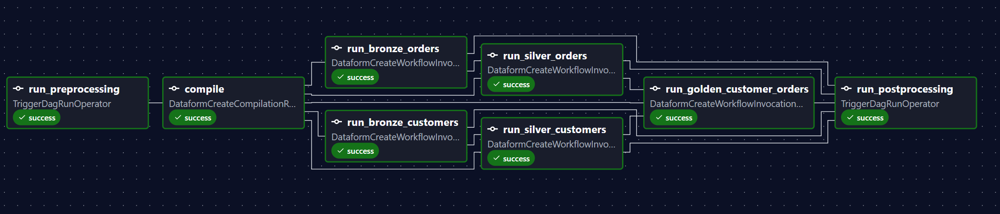
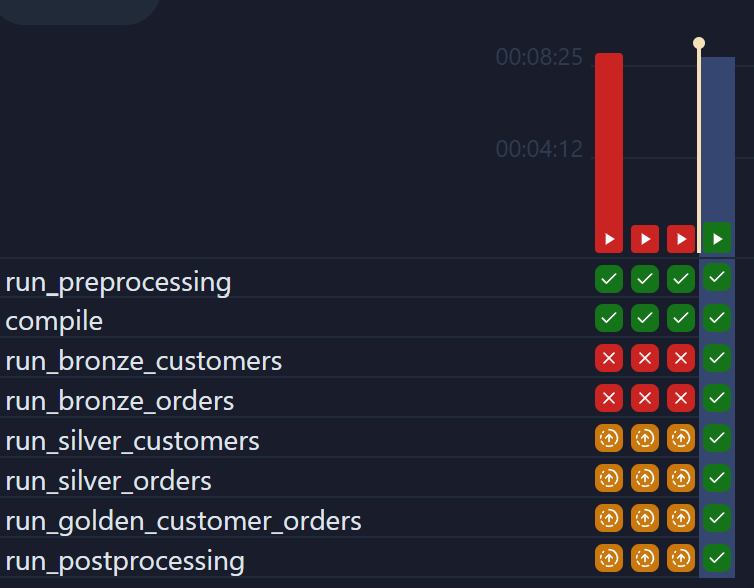
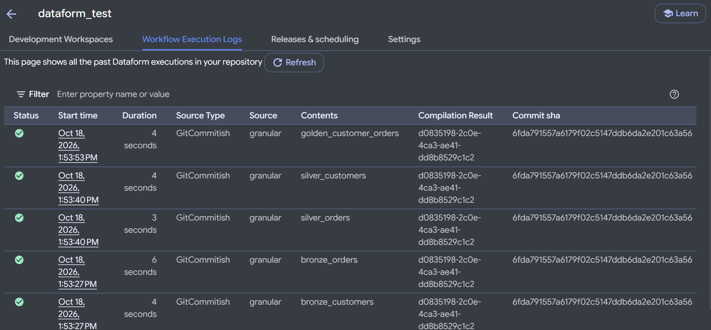

# dataform_test

A small Dataform project on BigQuery, orchestrated by a local Airflow instance. This README describes the **`granular`** branch: Airflow builds one task per Dataform action from the definitions, and each task runs only its own action. Airflow enforces the `ref()` order between the tasks.

Other branches (`main`, `coarse`, `single-task`) hold different structures for comparison. They are not covered here.

## What this branch does

```
Airflow (local, Docker)                              Dataform (GCP)
───────────────────────                              ──────────────
granular
  ├─ run_preprocessing  ──► granular_preprocessing
  │                         └─ check_gcp_access      (GCP preflight)
  ├─ compile            ──────────────────────────► compilation result of the git branch
  ├─ run_<action>       ──────────────────────────► one invocation per action (one task each)
  │   (one per action in definitions/, wired by ref() order)
  └─ run_postprocessing ──► granular_postprocessing  (placeholder)
```

The DAG has no hardcoded action names. `airflow/dags/dataform_graph.py` reads the SQLX files in `definitions/` and returns one task per action. Adding, renaming, or removing an action in `definitions/` changes the DAG on the next parse, with no DAG edit. How that parsing works, and the alternatives, are in [How the task graph is built](#how-the-task-graph-is-built).

### Screenshots

Airflow graph: the generated task graph. Each `run_<action>` task is one Dataform action, and the arrows follow the `ref()` dependencies.



Airflow run history: the grid of recent runs. Each column is one run, and each row is one task.



Dataform: the workflow execution log. Each row is one invocation, which is one action here.



## Repository layout

```
.
├── README.md                     this file
├── workflow_settings.yaml        Dataform project config (project and location placeholders)
├── definitions/                  Dataform SQLX actions (the source of the DAG)
│   ├── customers/                customer raw declaration, bronze, and silver actions
│   ├── orders/                   order raw declaration, bronze, and silver actions
│   └── customer_orders/          golden output
├── gcp/
│   └── seed_raw_tables.sql       creates the raw dataset and sample tables
├── images/                       screenshots used in this README
└── airflow/
    ├── docker-compose.yaml       local Airflow stack (LocalExecutor + PostgreSQL)
    ├── .env.example              template for .env (all GCP values are placeholders)
    ├── README.md                 Airflow operations notes
    ├── dags/
    │   ├── granular.py                    the pipeline DAG, one task per action
    │   ├── granular_preprocessing.py      runs the GCP preflight check
    │   ├── granular_postprocessing.py     placeholder for post-run steps
    │   ├── dataform_graph.py              reads definitions/ and returns the actions
    │   ├── dataform_config.py             project, region, repository, service account settings
    │   └── gcp_check.py                   preflight helper used by preprocessing
    ├── config/                   Airflow config folder (mounted, empty)
    ├── logs/                     task logs (gitignored)
    └── secrets/                  service account key goes here (gitignored)
```

The `airflow/` folder holds everything needed to run Airflow locally. The DAG code is in `airflow/dags/`.

## How the task graph is built

`dataform_graph.py` runs at DAG parse time. It reads every `*.sqlx` file under `DATAFORM_DEFINITIONS_DIR` and does three things:

1. Reads the `config { ... }` block for `schema`, `name`, and `type`. Declarations (`type: "declaration"`) are sources, so they get no task.
2. Collects every `${ref("...")}` in the file. A `ref()` to a declaration adds no dependency.
3. Returns one action per table or view, with its schema and its upstream actions.

`granular.py` then creates one `DataformCreateWorkflowInvocationOperator` per action, targeting that action only, and sets the dependencies from `upstream`.

The container sees the definitions at `DATAFORM_DEFINITIONS_DIR` (set in `docker-compose.yaml`), mounted from the repo's `definitions/` folder.

### Three ways to build the graph

The graph has to come from the definitions, and there are three places it can come from.

**1. Regex parsing of the SQLX files (current)**

- How it works: `dataform_graph.py` reads each `.sqlx` file and extracts `config` and `${ref(...)}` with regular expressions.
- Where it runs: in the Airflow DAG processor, at every parse (about every 30 seconds).
- Benefits: no extra tools, no network call, no build step. Changing a definition updates the DAG on the next parse.
- Downsides: a regex only understands the syntax it was written for. It misses `ref()` calls inside JavaScript blocks, `dependencies:` in config, and `ref()` with variables. The parser has to be updated when the SQLX syntax grows. Dataform's own view of the graph is not used, so the two can disagree.

**2. Reading the graph from the Dataform API**

- How it works: after `compile`, the DAG calls the API for the compilation result's actions (`queryCompilationResultActions`). Each action comes back with its target and its dependencies, as Dataform compiled them.
- Where it runs: the DAG needs the graph at parse time, so the call happens in the DAG processor. The result has to be cached (for example by commit SHA) because parsing happens every 30 seconds. A cache can live in a file under `airflow/` or in Airflow Variables.
- Benefits: this is Dataform's own graph, so it matches exactly what Dataform will run, including JavaScript refs and config dependencies. No SQL parsing.
- Downsides: parsing now needs credentials and network. The DAG depends on a compilation result that already exists, so the first run after a change needs a compile step first. The cache must be invalidated correctly, or the DAG shows a stale graph. This only works after `compile` has run for the commit being used.

**3. Generating a graph file with the Dataform CLI**

- How it works: the Dataform CLI compiles the project and writes the graph as JSON (`dataform compile --json`). The file is committed, or published as a build artifact, and the DAG reads it instead of the SQLX files.
- Where it runs: in a GitHub Actions workflow on each push (or in a pre-commit hook for local work). Inside the Airflow image, the file would also work if the CLI is installed there.
- Benefits: exact graph from Dataform, no network at parse time, and the DAG reads a plain JSON file. The same file can be reviewed in a pull request.
- Downsides: it needs Node and `@dataform/cli`, either in CI or in the Airflow image. The file can drift from `definitions/` unless CI checks it. It is one more artifact to keep in sync.

### What each option needs

| | 1. Regex parsing | 2. Dataform API | 3. CLI file via GitHub Actions |
|---|---|---|---|
| Source of truth at runtime | `definitions/*.sqlx`, read by the DAG processor | Dataform's compiled graph, fetched from the API | `airflow/dataform_graph.json`, committed to the repo |
| What must stay in sync | `definitions/` must exist wherever Airflow parses DAGs | A compilation result for the branch, and a cache refreshed when the commit changes | The JSON must match `definitions/`; CI regenerates it on every push |
| Local Airflow (today) | Works: compose mounts `definitions/` | Needs credentials and network at parse time | Works after `git pull`, since the file comes with the repo |
| Airflow on GCP (Cloud Composer) | Sync `definitions/` into the Composer bucket on every commit, so `DATAFORM_DEFINITIONS_DIR` points to it | Composer's service account calls the API (no key file). Needs a cache and a bootstrap run (see below) | Sync only the JSON file into the bucket on every commit. The DAG does not need `definitions/` at all |
| Work on each commit | Keep the bucket in sync | Nothing automatic. Each commit needs a compile before the graph is current | GitHub Action: compile, write the JSON, commit it, sync it to the bucket |
| Main failure mode | Drift if the sync is late. Regex misses syntax Dataform understands | Stale graph if the cache is not refreshed. API errors at parse time | CI fails when the committed JSON is out of date. Forgotten pull locally |
| Choose it when | Plain `ref()` only, small project | No CI, and the graph must match Dataform's runtime view exactly | Default choice: exact graph, no parse-time dependencies |

**What option 2 needs in practice.** Calling the API on every DAG parse is too slow and too fragile, so the call has to be cached:

1. A sync DAG (for example `granular_graph_sync`) runs after `compile`, or on demand. It takes the compilation result from the `compile` task, fetches its actions with the Dataform API (`queryCompilationResultActions`), and writes the result to a cache: an Airflow Variable locally, or an object in the Composer bucket on GCP.
2. The `granular` DAG reads the cache at parse time. If there is no cache yet, the DAG has no tasks, so the sync DAG has to run first (the bootstrap).
3. The cache key is the commit SHA of the compilation result. A new commit then produces a new cache entry.
4. The graph now depends on a previous run having happened, so the state lives outside git. This is the main reason option 3 is the default.

## Timing: granular vs single-task

Measured from the Airflow logs of one successful run per branch, on the same sample data:

| | `single_task` | `granular` |
|---|---|---|
| Total run time (wall clock) | 62 s | 77 s |
| `run_preprocessing` (preflight) | 16 s | 16 s |
| `compile` | 4 s | 4 s |
| Dataform execution in Airflow | 24 s (one invocation) | 13 s per task, 3 levels: about 40 s on the critical path |
| `run_postprocessing` | 16 s | 16 s |

Granular is about 1.25× slower here, not twice as slow. The preflight and postprocessing steps are about 30 s of the total for both branches, so they dominate on small data. Dataform's own execution is only a few seconds per action on this sample (3–6 s per invocation in the Dataform log), so the extra time comes from Airflow: each task has its own invocation and polling interval, and the tasks run in levels that follow the `ref()` order.

On real data, Dataform execution will take longer and dominate the total. The granular overhead then grows with the number of dependency levels rather than with the number of actions, because independent actions run in parallel. Deeper graphs cost more than wide ones. This is one run per branch, so treat the numbers as a rough guide.

## Running from scratch

For a clean rerun, for example after changing many files:

```bash
cd airflow
docker compose down           # keeps the metadata DB
docker compose up -d          # reloads .env, docker-compose.yaml, and DAGs
```

To wipe Airflow's metadata (run history, DAG records):

```bash
docker compose down -v
```

Dataform's outputs in BigQuery are not affected by either command.
## STEPS TO REPRODUCE THE PIPELINE

Replace the placeholders as you go:

| Placeholder | Meaning | Example |
|---|---|---|
| `<PROJECT_ID>` | GCP project ID | `my-analytics-123456` |
| `<PROJECT_NUMBER>` | Numeric project number (`gcloud projects describe <PROJECT_ID> --format='value(projectNumber)'`) | `123456789012` |
| `<REGION>` | Dataform region | `us-central1` |
| `<REPO_ID>` | Dataform repository ID | `dataform_test` |
| `<SA_NAME>` | Airflow service account name | `airflow-datatform` |

### 1. Set the project in Dataform config

Dataform needs a default project, and the Airflow DAG sets it at compile time from `GCP_PROJECT_ID`. Keep `workflow_settings.yaml` at its placeholder so the project ID stays out of the repository:

```yaml
defaultProject: REPLACE_WITH_GCP_PROJECT_ID   # overridden at compile time by the DAG
defaultLocation: US
defaultDataset: dataform
dataformCoreVersion: 3.1.0
```

`defaultLocation` must match the location of the raw dataset (step 4).

### 2. Create the Dataform repository

In the console: **BigQuery → Dataform → Create repository**. Use `<REGION>` and `<REPO_ID>`. Connect it to this repository's git remote and set the default branch to `main`. Connecting to git needs Developer Connect or an HTTPS/SSH secret.

### 3. Create the Airflow service account and key

```bash
gcloud iam service-accounts create <SA_NAME> --project=<PROJECT_ID>

SA=<SA_NAME>@<PROJECT_ID>.iam.gserviceaccount.com

# Dataform access for the DAG (repository reads, workflow invocations)
gcloud projects add-iam-policy-binding <PROJECT_ID> \
  --member="serviceAccount:$SA" --role="roles/dataform.editor"

# Strict act-as: the caller must be allowed to act as the account it names
gcloud iam service-accounts add-iam-policy-binding "$SA" --project=<PROJECT_ID> \
  --member="serviceAccount:$SA" --role="roles/iam.serviceAccountUser"

# The account runs the BigQuery jobs, so it needs BigQuery access
for role in roles/bigquery.dataEditor roles/bigquery.jobUser; do
  gcloud projects add-iam-policy-binding <PROJECT_ID> \
    --member="serviceAccount:$SA" --role="$role"
done

# Dataform's service agent must be allowed to create tokens for that account
gcloud iam service-accounts add-iam-policy-binding "$SA" --project=<PROJECT_ID> \
  --member="serviceAccount:service-<PROJECT_NUMBER>@gcp-sa-dataform.iam.gserviceaccount.com" \
  --role="roles/iam.serviceAccountTokenCreator"

# Create the JSON key and save it where the stack expects it (gitignored)
gcloud iam service-accounts keys create airflow/secrets/gcp-sa.json --iam-account="$SA"
```

IAM changes can take a few minutes to take effect. If you see a permission error right after granting, wait and retry.

### 4. Seed the raw tables

Creates the `raw` dataset with sample customers and orders. The Dataform declarations read from it.

```bash
bq query --project_id=<PROJECT_ID> --location=US --use_legacy_sql=false < gcp/seed_raw_tables.sql
```

The location must match `defaultLocation` in `workflow_settings.yaml`.

### 5. Create the local `.env`

```bash
cd airflow
cp .env.example .env
```

Edit `airflow/.env`:

```dotenv
GCP_PROJECT_ID=<PROJECT_ID>
DATAFORM_REGION=<REGION>
DATAFORM_REPOSITORY_ID=<REPO_ID>
FERNET_KEY=<generated>
```

Generate `FERNET_KEY` once:

```bash
python3 -c "import base64,os;print(base64.urlsafe_b64encode(os.urandom(32)).decode())"
```

Set `AIRFLOW_UID` to `id -u` on your host. Other values in `.env.example` are fine for local use.

The DAG reads `GCP_PROJECT_ID` both for the Dataform calls and for the compile setting, so it must be correct.

### 6. Push the branch

Dataform compiles the git branch from the remote, not from your working tree. Push `granular` before any run:

```bash
git push origin granular
```

The Airflow DAG code is read from your local `airflow/dags/`, so DAG changes take effect without a push. Dataform definition changes do need a push, and a new action appears in Airflow after the push and the next DAG parse.

### 7. Start Airflow

From `airflow/`:

```bash
docker compose up airflow-init        # first start only: migrates the DB, creates the admin user
docker compose up -d                  # start everything in the background
docker compose ps                     # all services should be healthy
```

Open http://localhost:8080, or the port in `AIRFLOW_PORT` if you changed it. Log in with the username and password from `.env` (default `airflow` / `airflow`).

**Important:** Docker reads `.env` and `docker-compose.yaml` only when containers are created. After you change either, run `docker compose up -d` again. A plain `restart` keeps the old values.

### 8. Run the pipeline

In the UI, open `granular` and click **Trigger**. Or from the command line:

```bash
docker compose run --rm airflow-cli airflow dags trigger granular
```

Expected result:

1. `run_preprocessing` triggers `granular_preprocessing`, which runs `check_gcp_access`.
2. `compile` compiles the pushed branch in Dataform.
3. Every `run_<action>` task runs its action as one invocation. Tasks run as soon as their `ref()` parents succeed.
4. `run_postprocessing` triggers `granular_postprocessing`, a placeholder.

Results appear in BigQuery under the `bronze`, `silver`, and `golden` datasets, and in the Dataform execution logs (screenshot above).
