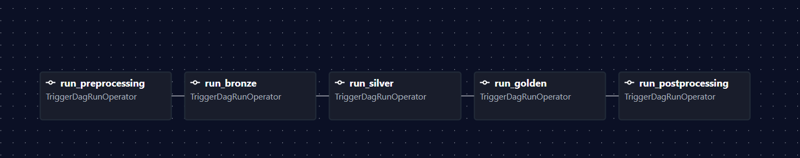
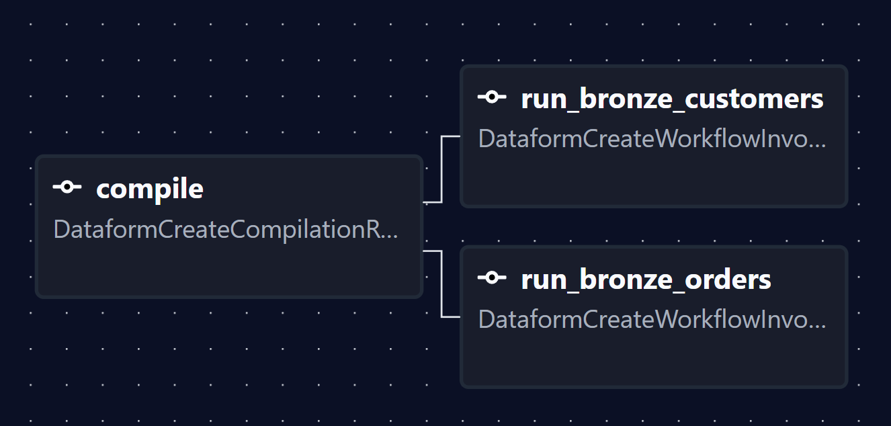
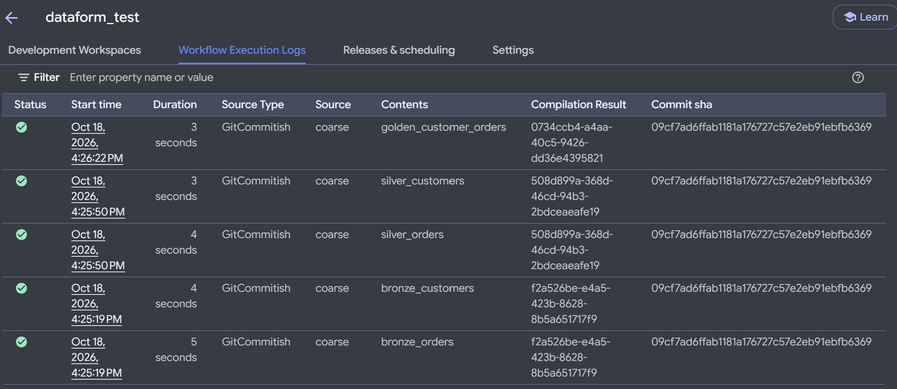

# dataform_test

A small Dataform project on BigQuery, orchestrated by a local Airflow instance. This README describes the **`coarse`** branch: Airflow builds one DAG per layer (tag) from the definitions. Each layer DAG compiles the branch once and runs every action with that tag as its own task, so each table is a separate vertex in the Airflow UI. A main DAG runs the layers in the order they depend on each other.

Other branches (`main`, `granular`, `single-task`) hold different structures for comparison. They are not covered here.

## What this branch does

```
Airflow (local, Docker)                              Dataform (GCP)
───────────────────────                              ──────────────
coarse
  ├─ run_preprocessing  ──► coarse_preprocessing
  │                         └─ check_gcp_access      (GCP preflight)
  ├─ run_bronze         ──► coarse_bronze
  │                         ├─ compile                 ──► compilation result of the git branch
  │                         ├─ run_bronze_customers    ──► one invocation for this table
  │                         └─ run_bronze_orders       ──► one invocation for this table
  ├─ run_silver         ──► coarse_silver          (same pattern, tag "silver")
  ├─ run_golden         ──► coarse_golden          (same pattern, tag "golden")
  └─ run_postprocessing ──► coarse_postprocessing  (placeholder)
```

The DAGs have no hardcoded layer names. `airflow/dags/dataform_graph.py` reads the SQLX files in `definitions/`, and `coarse_layers.py` creates one DAG per tag it finds. Adding a new tag (a new layer) in `definitions/` creates a new DAG on the next parse, with no DAG edit. How the layers and their order are derived is in [How the layer DAGs are built](#how-the-layer-dags-are-built).

Each table is its own Airflow task, so you can see, retry, and clear each one separately in the UI. Airflow orders the tables inside a layer by `ref()`, and orders the layers by the same rule.

### Screenshots

Airflow main DAG: the `coarse` graph. Each `run_<layer>` task is a trigger for one layer DAG, and the layers run in order between preprocessing and postprocessing.



Airflow layer DAG: the `coarse_bronze` graph. `compile` fans out to one task per table, and each table is its own vertex.



Dataform: the workflow execution log. Each row is one table invocation, and the rows share the same compilation result and commit.



## Repository layout

```
.
├── README.md                     this file
├── workflow_settings.yaml        Dataform project config (project and location placeholders)
├── definitions/                  Dataform SQLX actions (the source of the layers)
│   ├── raw/                      declarations of the raw source tables (no tag, not run)
│   ├── bronze/                   tag "bronze": copies of raw tables
│   ├── silver/                   tag "silver": cleaned tables
│   └── golden/                   tag "golden": business output
├── gcp/
│   └── seed_raw_tables.sql       creates the raw dataset and sample tables
└── airflow/
    ├── docker-compose.yaml       local Airflow stack (LocalExecutor + PostgreSQL)
    ├── .env.example              template for .env (all GCP values are placeholders)
    ├── README.md                 Airflow operations notes
    ├── dags/
    │   ├── coarse.py                      the main DAG: runs preprocessing, layers, postprocessing
    │   ├── coarse_layers.py               creates one coarse_<layer> DAG per tag
    │   ├── coarse_preprocessing.py        runs the GCP preflight check
    │   ├── coarse_postprocessing.py       placeholder for post-run steps
    │   ├── dataform_graph.py              reads definitions/ and returns actions, tags, and layer order
    │   ├── dataform_config.py             project, region, repository, service account settings
    │   └── gcp_check.py                   preflight helper used by preprocessing
    ├── config/                   Airflow config folder (mounted, empty)
    ├── logs/                     task logs (gitignored)
    └── secrets/                  service account key goes here (gitignored)
```

The `airflow/` folder holds everything needed to run Airflow locally. The DAG code is in `airflow/dags/`.

## How the layer DAGs are built

`dataform_graph.py` runs at DAG parse time. It reads every `*.sqlx` file under `DATAFORM_DEFINITIONS_DIR` and does four things:

1. Reads the `config { ... }` block for `schema`, `name`, `type`, and `tags`. Declarations (`type: "declaration"`) are sources, so they are not actions.
2. Collects every `${ref("...")}` in the file. A `ref()` to a declaration adds no dependency.
3. Fails with a clear error if an action has no tag, because an untagged action would never run in any layer.
4. Works out the layer order. A layer depends on another layer when one of its actions refs an action in that layer. The order is a topological sort, and a cycle between layers is an error.

`coarse_layers.py` then creates one DAG per layer, named `coarse_<layer>`. Each one has:

- `compile`: a `DataformCreateCompilationResultOperator` for the git branch. One per layer DAG.
- `run_<action>`: one `DataformCreateWorkflowInvocationOperator` per action with that layer's tag. Each one targets its own table with `included_targets`, so each table is a separate task.

Within a layer, a `ref()` between two actions becomes a task dependency. A `ref()` to an action in another layer does not: the main DAG runs the layers in order instead.

`coarse.py` creates the main DAG. It triggers `coarse_preprocessing`, then each layer DAG in the computed order, then `coarse_postprocessing`. Each step waits for the previous one to succeed.

The container sees the definitions at `DATAFORM_DEFINITIONS_DIR` (set in `docker-compose.yaml`), mounted from the repo's `definitions/` folder.

### What this means for changes

- **Adding an action to an existing layer:** add the SQLX file with that layer's tag. A new `run_<action>` task appears in that layer's DAG with no DAG change.
- **An action with two tags:** it runs in both layer DAGs, so it is executed twice per run. Use one tag per action unless that is what you want.
- **Adding a new layer:** add a new tag to some action. A new `coarse_<layer>` DAG appears on the next parse, and the main DAG runs it in its dependency position.
- **Removing a layer:** remove its tag from every action. The DAG disappears on the next parse, but Airflow keeps the old run history.
- **Compile runs once per layer:** each layer DAG compiles the branch itself, so the branch is compiled once per layer on every run.

## STEPS TO REPRODUCE THE PIPELINE

Replace the placeholders as you go:

| Placeholder | Meaning | Example |
|---|---|---|
| `<PROJECT_ID>` | GCP project ID | `my-analytics-123456` |
| `<PROJECT_NUMBER>` | Numeric project number (`gcloud projects describe <PROJECT_ID> --format='value(projectNumber)'`) | `123456789012` |
| `<REGION>` | Dataform region | `us-central1` |
| `<REPO_ID>` | Dataform repository ID | `dataform_test` |
| `<SA_NAME>` | Airflow service account name | `airflow-datatform` |

### 1. Set the project in Dataform config

Dataform needs a default project, and the Airflow DAG sets it at compile time from `GCP_PROJECT_ID`. Keep `workflow_settings.yaml` at its placeholder so the project ID stays out of the repository:

```yaml
defaultProject: REPLACE_WITH_GCP_PROJECT_ID   # overridden at compile time by the DAG
defaultLocation: US
defaultDataset: dataform
dataformCoreVersion: 3.1.0
```

`defaultLocation` must match the location of the raw dataset (step 4).

### 2. Create the Dataform repository

In the console: **BigQuery → Dataform → Create repository**. Use `<REGION>` and `<REPO_ID>`. Connect it to this repository's git remote and set the default branch to `main`. Connecting to git needs Developer Connect or an HTTPS/SSH secret.

### 3. Create the Airflow service account and key

```bash
gcloud iam service-accounts create <SA_NAME> --project=<PROJECT_ID>

SA=<SA_NAME>@<PROJECT_ID>.iam.gserviceaccount.com

# Dataform access for the DAG (repository reads, workflow invocations)
gcloud projects add-iam-policy-binding <PROJECT_ID> \
  --member="serviceAccount:$SA" --role="roles/dataform.editor"

# Strict act-as: the caller must be allowed to act as the account it names
gcloud iam service-accounts add-iam-policy-binding "$SA" --project=<PROJECT_ID> \
  --member="serviceAccount:$SA" --role="roles/iam.serviceAccountUser"

# The account runs the BigQuery jobs, so it needs BigQuery access
for role in roles/bigquery.dataEditor roles/bigquery.jobUser; do
  gcloud projects add-iam-policy-binding <PROJECT_ID> \
    --member="serviceAccount:$SA" --role="$role"
done

# Dataform's service agent must be allowed to create tokens for that account
gcloud iam service-accounts add-iam-policy-binding "$SA" --project=<PROJECT_ID> \
  --member="serviceAccount:service-<PROJECT_NUMBER>@gcp-sa-dataform.iam.gserviceaccount.com" \
  --role="roles/iam.serviceAccountTokenCreator"

# Create the JSON key and save it where the stack expects it (gitignored)
gcloud iam service-accounts keys create airflow/secrets/gcp-sa.json --iam-account="$SA"
```

IAM changes can take a few minutes to take effect. If you see a permission error right after granting, wait and retry.

### 4. Seed the raw tables

Creates the `raw` dataset with sample customers and orders. The Dataform declarations read from it.

```bash
bq query --project_id=<PROJECT_ID> --location=US --use_legacy_sql=false < gcp/seed_raw_tables.sql
```

The location must match `defaultLocation` in `workflow_settings.yaml`.

### 5. Create the local `.env`

```bash
cd airflow
cp .env.example .env
```

Edit `airflow/.env`:

```dotenv
GCP_PROJECT_ID=<PROJECT_ID>
DATAFORM_REGION=<REGION>
DATAFORM_REPOSITORY_ID=<REPO_ID>
FERNET_KEY=<generated>
```

Generate `FERNET_KEY` once:

```bash
python3 -c "import base64,os;print(base64.urlsafe_b64encode(os.urandom(32)).decode())"
```

Set `AIRFLOW_UID` to `id -u` on your host. Other values in `.env.example` are fine for local use.

The DAG reads `GCP_PROJECT_ID` both for the Dataform calls and for the compile setting, so it must be correct.

### 6. Push the branch

Dataform compiles the git branch from the remote, not from your working tree. Push `coarse` before any run:

```bash
git push origin coarse
```

The Airflow DAG code is read from your local `airflow/dags/`, so DAG changes take effect without a push. Dataform definition changes do need a push, and a new layer appears in Airflow after the push and the next DAG parse.

### 7. Start Airflow

From `airflow/`:

```bash
docker compose up airflow-init        # first start only: migrates the DB, creates the admin user
docker compose up -d                  # start everything in the background
docker compose ps                     # all services should be healthy
```

Open http://localhost:8080, or the port in `AIRFLOW_PORT` if you changed it. Log in with the username and password from `.env` (default `airflow` / `airflow`).

**Important:** Docker reads `.env` and `docker-compose.yaml` only when containers are created. After you change either, run `docker compose up -d` again. A plain `restart` keeps the old values.

**Also after switching branches:** the `definitions/` folder is replaced when you check out another branch, and the containers keep the old folder. Recreate the containers that mount it, or the DAGs will see no definitions:

```bash
docker compose up -d --force-recreate airflow-scheduler airflow-dag-processor airflow-apiserver airflow-triggerer
```

### 8. Run the pipeline

In the UI, open `coarse` and click **Trigger**. Or from the command line:

```bash
docker compose run --rm airflow-cli airflow dags trigger coarse
```

Expected result:

1. `run_preprocessing` triggers `coarse_preprocessing`, which runs `check_gcp_access`.
2. `run_bronze` triggers `coarse_bronze`. It compiles the branch, then runs each action tagged `bronze` as its own task (`run_bronze_customers`, `run_bronze_orders`).
3. `run_silver` and then `run_golden` do the same for their tags, in dependency order.
4. `run_postprocessing` triggers `coarse_postprocessing`, a placeholder.

Results appear in BigQuery under the `bronze`, `silver`, and `golden` datasets, and in the Dataform execution logs.

## Running from scratch

For a clean rerun, for example after changing many files:

```bash
cd airflow
docker compose down           # keeps the metadata DB
docker compose up -d          # reloads .env, docker-compose.yaml, and DAGs
```

To wipe Airflow's metadata (run history, DAG records):

```bash
docker compose down -v
```

Dataform's outputs in BigQuery are not affected by either command.
